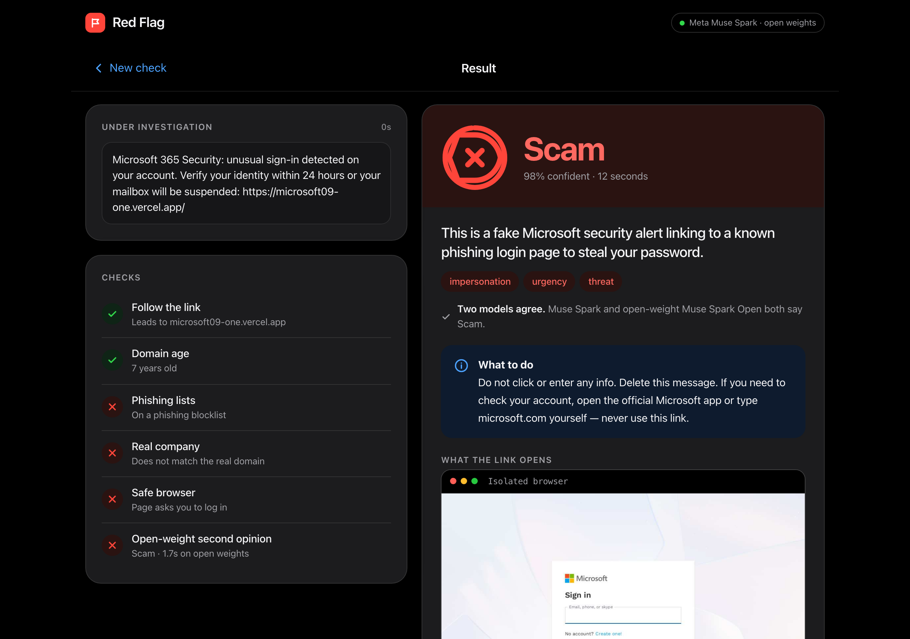
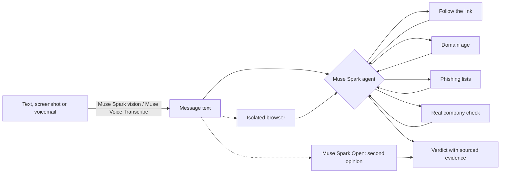

# 🚩 Red Flag

**Forward a suspicious text, email, screenshot or voicemail. An AI agent investigates it like a fraud analyst and shows its proof.**

[**Try the live app**](https://rahulmuddhapuram--redflag-web-web.us-east.modal.run) · [**Watch the 3-minute demo**](https://youtu.be/P2-BnjaAro8) · [Technical details](docs/TECHNICAL.md)

<p align="center"></p>

*A real run: a live phishing page, opened safely in an isolated browser, caught in seconds with the evidence shown. Every claim in the verdict links back to the check that found it.*

Built solo for the **Meta Global AI Developer Hackathon** (Indie track, "Build for Your World") with Meta's Muse Spark.

## The problem

Scams cost people billions every year, and older adults and non-English speakers are hit hardest. A spam filter says "maybe spam" and stops. It never tells you **why**, or **what to do**.

## What Red Flag does

1. **You send it a message:** paste text, drop a screenshot, or upload a voicemail.
2. **An agent investigates, and you watch it work.** It follows the link, checks how old the domain is, checks phishing lists, compares the link with the real company's official domains, and opens the page in an isolated cloud browser (never on your device).
3. **You get a clear verdict:** **Scam**, **Suspicious** or **Looks Safe**, with every reason tied to the check that found it, plus what to do next. The answer comes back in the language of the message.

## How it works

Two models work together: Muse Spark investigates and writes the verdict with sources, while Muse Spark Open gives a fast independent opinion, so you see agreement or disagreement at a glance.



- **Muse Spark** decides which checks to run, reads the results, and writes the verdict (tool calling, reasoning, vision).
- **Muse Voice Transcribe** turns voicemails into text.
- **Muse Spark Open** (open weights, on Baseten) gives an independent second opinion in about two seconds. The whole agent can also run on it, and the app switches between the two models if one is down.
- **Modal** runs the isolated browser and hosts the live app.

## Does it work? (honest results)

Tested on 179 hand-written and live-phishing messages, including look-alike legitimate ones:

| | False alarms (of 90 legitimate) | Scams caught (of 89) |
|---|---|---|
| Muse Spark alone, no tools | 5 | 88 |
| **Red Flag agent** | **1** | **89** |

- The gap in false alarms points the right way but is **not statistically significant** (p = 0.21). Muse Spark alone is already strong. The agent's real value is **evidence you can verify**.
- It resisted **24 of 24** prompt-injection attacks, and caught **all 18** scams in six languages, with the answer in the right language.
- 157 automated tests (backend, browser UI, and a 39-case hostile-input fuzz).
- Our test sets are small and mostly written by us, so real-world results will be harder. Full numbers, confidence intervals and limitations: [`evals/RESULTS.md`](evals/RESULTS.md) and [`docs/TECHNICAL.md`](docs/TECHNICAL.md).

## Run it yourself

```bash
python3 -m venv .venv && source .venv/bin/activate
pip install -r requirements.txt
cp .env.example .env                           # add your MODEL_API_KEY (Meta Model API)
uvicorn redflag.api.server:app --port 8000     # open http://localhost:8000
```

Or with Docker:

```bash
docker build -t redflag . && docker run --env-file .env -p 8000:8000 redflag
```

Optional: add `BASETEN_API_KEY` for the open-weight model, and run `modal token new` to enable the isolated browser. Run the tests with `pip install -r requirements-dev.txt && playwright install chromium && pytest`.

## Project layout

| Path | What lives there |
|---|---|
| `redflag/agent/` | The investigation loop: tool calls, streaming events, failover between Muse Spark and Muse Spark Open, verdict safety floor |
| `redflag/tools/` | The checks: link following, domain age (RDAP), phishing lists, official-domain comparison, email sender analysis, isolated-browser sandbox |
| `redflag/inputs.py` | Screenshot (vision) and voicemail (Muse Voice Transcribe) to text |
| `redflag/api/` | FastAPI server: live event stream, rate limits, daily cap, security headers |
| `web/` | The single-page UI (plain HTML and JS, strict content-security policy) |
| `deploy/` | Modal deployment for the live app and the isolated browser |
| `evals/`, `scripts/` | Evaluation sets, runners, confidence intervals, latency and fuzz tests |
| `tests/` | 157 automated tests, including browser UI tests |

## Safety, built in

- Never contacts the sender, and never sends your message to any link in it.
- Links are opened only inside an isolated, throwaway cloud browser. Internal and private addresses are blocked.
- Treats the message, page text and tool output as untrusted data, so scam text cannot take control of the investigator.
- Keeps nothing after the check. API keys live only in `.env`, which is never committed.

## Limitations (what it does not do yet)

Small test sets, mostly written by us; the open-weight model is noisier on casual chat; official-company details cover about 65 commonly impersonated brands; no email-header (SPF/DKIM) checks yet; report links are US-specific; the public demo has a daily request cap to protect API credits.

## Built during the hackathon

Everything here was written during the event (first commit: Oct 26, 2026, after the 12:00 PM ET kickoff). See `git log`.

**Data:** UCI SMS Spam Collection (Almeida & Hidalgo, CC BY 4.0) for a held-out sample, and a snapshot of the OpenPhish community feed for a small live-phishing test set. Everything else was written for this project.

## License

[MIT](LICENSE)
