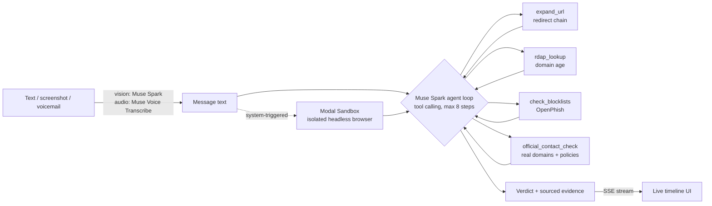

# 🚩 Red Flag

**Forward any suspicious text, email, screenshot or voicemail. An AI agent investigates it like a fraud analyst and returns an evidence-backed verdict in seconds.**

Built solo for the Meta Global AI Developer Hackathon (Indie track, "Build for Your World").

Spam filters say "maybe spam". Red Flag shows *why*: where the link really goes, how old the domain is, whether it's on a phishing list, what the real company's official domain is, and what the page itself asks you to type, opened in an isolated cloud browser, never on your device.

## Demo flow
1. Paste a text (or drop a screenshot, or a voicemail).
2. Watch the live investigation timeline fill in as the agent works.
3. Get a verdict card (Scam / Suspicious / Looks Safe) with every claim tied to the tool that found it, plus what to do next.

## How it works



- **Agent**: Muse Spark (`muse-spark-1.3`) reasons, picks tools, reads results, repeats, then calls `submit_verdict`. Tools in a round run in parallel. Hard cap of 8 steps and capped tokens.
- **Vision**: screenshots are transcribed by Muse Spark's vision, then investigated like any message.
- **Voicemail**: Muse Voice Transcribe (`muse-voice-transcribe-1.0`, WAV only; the browser converts any audio to 16 kHz WAV, mic recording included).
- **Safe link inspection**: the system opens the first non-official link in a throwaway Modal Sandbox (headless Chromium, no secrets, no form input, downloads blocked) and returns the page text, login fields, where forms post, and a screenshot. Links on known official domains are never opened.
- **Prompt-injection hygiene**: the message, page text and tool output are treated as untrusted data.

## Evaluation (real numbers, reproducible)
Full tables with confidence intervals: [`evals/RESULTS.md`](evals/RESULTS.md). Reproduce with `scripts/run_all_evals.sh` (about 30 min, a few dollars of API credits).

Pooled over the hand-written benchmark, the hard-text set and the live-phishing pairs (the sets with realistic scams and look-alike legitimate messages):

| | False alarms on 90 legitimate messages | Scams caught (of 89) |
|---|---|---|
| Muse Spark alone (no tools) | 5 (5.6%) | 88 |
| **Red Flag agent** | **0 (0.0%, 95% CI 0-4.1%)** | **89** |

What this does and doesn't show (stated plainly):
- **Muse Spark alone is already strong** (96-99% accuracy). The agent doesn't win on raw accuracy; the gap in false alarms (0/90 vs 5/90, Fisher p = 0.059) is suggestive, not conclusive.
- The agent's real value is **verified, shown evidence**, and fewer false alarms on real brand messages because it checks the official domain instead of guessing.
- The agent reserves "Scam" for concrete evidence. Polite scams with nothing checkable come back "Suspicious", so strict ("Scam" only) recall on the hard-text set is 65% vs 85% for the baseline. That's a deliberate calibration.
- **Live-phishing pairs**: each live phishing URL (OpenPhish snapshot, Oct 26 2026, stored defanged) is paired with the same message using the brand's real URL. The labels and the blocklist check come from the same feed, so we also ran an ablation without the blocklist: 100% accuracy on both sets, carried by redirects, domain checks and official-domain comparison.
- **UCI SMS Spam is spam, not scams** (many are real O2/Orange promotions). We tuned the prompt on one UCI sample, then report only a **fresh held-out sample** (seed 99, no overlap).
- Hand-written benchmark messages and training templates were written by the same author; the Glimmer training data was filtered against every eval message (756 candidates dropped for overlap).
- Model outputs vary run to run; the baseline's false-alarm rate on one set moved from 3% to 13% across two runs. Small samples; treat differences accordingly.

## Safety rules (built in)
- Never replies to or contacts scammers.
- Never sends user content to any URL found in a message; link fetches carry no user data and block private/internal addresses.
- Suspicious pages are opened only inside an isolated Modal Sandbox.
- No message content is written to disk by the app; use synthetic or public examples while on free API credits (Meta may use content on free credits).
- Keys stay in `.env` (git-ignored); the front end never sees them. Token and step caps limit runaway cost.

## Setup
```bash
python3 -m venv .venv && source .venv/bin/activate
pip install -r requirements.txt
cp .env.example .env            # add MODEL_API_KEY (Meta Model API)
modal token new                 # optional: enables the link sandbox
uvicorn redflag.api.server:app --port 8000   # open http://localhost:8000
python scripts/investigate.py samples/usps_smish.txt   # CLI
```

## Repo map
`redflag/agent` the loop · `redflag/tools` URL expansion, RDAP, blocklists, official-contact DB, Modal sandbox · `redflag/inputs.py` vision + transcription · `redflag/api` FastAPI SSE server · `web/` UI · `evals/` datasets, runner, results · `training/` Muse Glimmer triage fine-tuning · `docs/DEMO_SCRIPT.md`.

## Built during the hackathon
Everything in this repository was written during the event. First commit: Oct 26 2026, 1:18 PM ET, after the 12:00 PM ET kickoff. Organizers confirmed in Discord #questions that post-kickoff work on Oct 26 counts as the building period. See `git log` for the full history.

## Data and attribution
- UCI SMS Spam Collection, Almeida & Hidalgo (2011), CC BY 4.0, doi:10.24432/C5CC84 (evaluation sample and part of the Glimmer training data).
- OpenPhish community feed (openphish.com), a snapshot used only for a small live-phishing test set, stored defanged.
- All other messages and templates were written for this project (CC0). Muse Spark outputs were **not** used as training data.

## Status
Muse Glimmer 30B first-pass triage fine-tune (Modal, QLoRA): in progress. This README will only claim results that exist in `evals/results/`.
