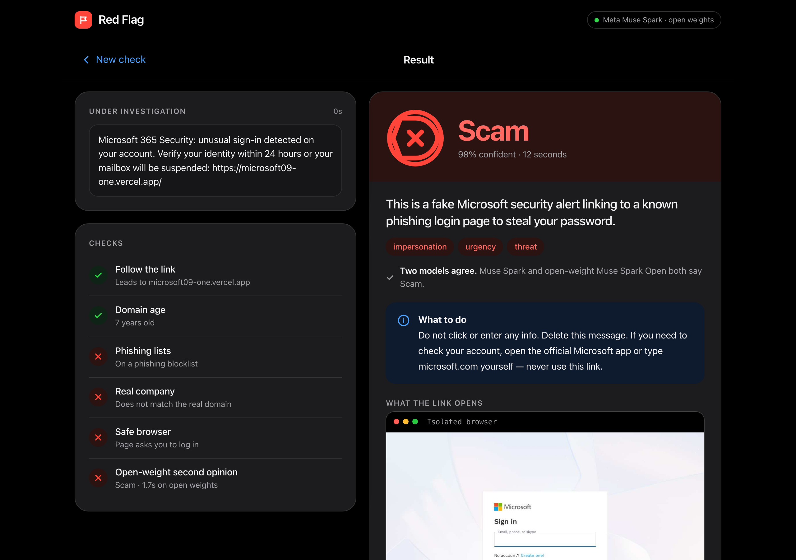
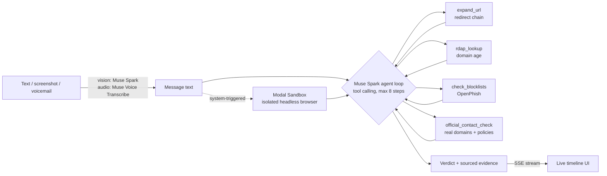

# Red Flag: technical details

The short version is in the [README](../README.md). This page has the full evaluation, speed, robustness and open-weight notes.

**Live demo:** https://rahulmuddhapuram--redflag-web-web.us-east.modal.run  (daily request cap to protect API credits; if it says the daily limit is reached, run it locally, see Setup)


<p align="center"></p>

*A real run: a live phishing page from today's feed, opened inside an isolated browser, caught in 12 seconds with the evidence shown.*

**Forward any suspicious text, email, screenshot or voicemail. An AI agent investigates it like a fraud analyst and returns an evidence-backed verdict in seconds.**

Built solo for the Meta Global AI Developer Hackathon (Indie track, "Build for Your World").

Spam filters say "maybe spam". Red Flag shows *why*: where the link really goes, how old the domain is, whether it's on a phishing list, what the real company's official domain is, and what the page itself asks you to type, opened in an isolated cloud browser, never on your device.

## Demo flow
1. Paste a text (or drop a screenshot, or a voicemail).
2. Watch the live investigation timeline fill in as the agent works.
3. Get a verdict card (Scam / Suspicious / Looks Safe) with every claim tied to the tool that found it, plus what to do next.

## How it works



- **Agent**: Muse Spark (`muse-spark-1.3`) reasons, picks tools, reads results, repeats, then calls `submit_verdict`. Tools in a round run in parallel. Hard cap of 8 steps and capped tokens.
- **Vision**: screenshots are transcribed by Muse Spark's vision, then investigated like any message.
- **Voicemail**: Muse Voice Transcribe (`muse-voice-transcribe-1.0`, WAV only; the browser converts any audio to 16 kHz WAV, mic recording included).
- **Safe link inspection**: the system opens the first non-official link in a throwaway Modal Sandbox (headless Chromium, no secrets, no form input, downloads blocked) and returns the page text, login fields, where forms post, and a screenshot. Links on known official domains are never opened.
- **Prompt-injection hygiene**: the message, page text and tool output are treated as untrusted data.

## Evaluation (real numbers, reproducible)
Full tables with confidence intervals: [`evals/RESULTS.md`](../evals/RESULTS.md). Reproduce with `scripts/run_all_evals.sh` (about 30 min, a few dollars of API credits).

Pooled over the hand-written benchmark, the hard-text set and the live-phishing pairs (the sets with realistic scams and look-alike legitimate messages):

| | False alarms on 90 legitimate messages | Scams caught (of 89) |
|---|---|---|
| Muse Spark alone (no tools) | 5 (5.6%) | 88 |
| **Red Flag agent** | **1 (1.1%, 95% CI 0.2-6.0%)** | **89** |

What this does and doesn't show (stated plainly):
- **Muse Spark alone is already strong** (96-99% accuracy). The agent doesn't win on raw accuracy; the gap in false alarms (1/90 vs 5/90, Fisher p = 0.21) points the right way but is **not statistically significant**. Earlier full runs of the same sets gave 0/90 and 1/90 for the agent, so expect run-to-run variation.
- The agent's real value is **verified, shown evidence**, and fewer false alarms on real brand messages because it checks the official domain instead of guessing.
- The agent reserves "Scam" for concrete evidence. Polite scams with nothing checkable come back "Suspicious", so strict ("Scam" only) recall on the hard-text set is 55% vs 95% for the baseline. That's a deliberate calibration.
- **Live-phishing pairs**: each live phishing URL (OpenPhish snapshot, Oct 26 2026, stored defanged) is paired with the same message using the brand's real URL. The labels and the blocklist check come from the same feed, so we also ran an ablation without the blocklist: 100% accuracy on both sets, carried by redirects, domain checks and official-domain comparison.
- **UCI SMS Spam is spam, not scams** (many are real O2/Orange promotions). We tuned the prompt on one UCI sample, then report only a **fresh held-out sample** (seed 99, no overlap).
- The hand-written benchmark, hard-text, injection and multilingual messages were written by the same author as the prompt, so they are friendlier than real-world traffic.
- Model outputs vary run to run; the baseline's false-alarm rate on one set moved from 3% to 13% across two runs. Small samples; treat differences accordingly.

## Speed

The agent now needs **1.4 model calls per investigation instead of 2.3** (measured on 24 messages, load-independent). Median time to a verdict on that benchmark fell from 9.4 s to 4.4 s in a quiet period; in the busy final days the Meta API was slower and the same benchmark measured 8.4 s (full-eval medians 7-16 s), so real latency depends on API load. Three changes did it, each measured: the standard checks (redirects, domain age, phishing feeds, official-company details) run in parallel *before* the first model call so the model usually answers in one round; reasoning effort is lowered when the evidence is already in hand (closed Muse Spark only, because the open model got worse at low effort in our tests); and repeated tool calls are answered from memory. The open-weight second opinion typically appears on screen after 2-3 seconds. Per-set table in `evals/RESULTS.md`; reproduce with `scripts/run_final_evals.sh` and `scripts/bench_latency.py`.

## Safety rules (built in)
- Never replies to or contacts scammers.
- Never sends user content to any URL found in a message; link fetches carry no user data and block private/internal addresses.
- Suspicious pages are opened only inside an isolated Modal Sandbox.
- No message content is written to disk by the app; use synthetic or public examples while on free API credits (Meta may use content on free credits).
- Keys stay in `.env` (git-ignored); the front end never sees them. Token and step caps limit runaway cost.

## Robustness

**Multilingual:** 36 scam and legitimate messages in Spanish, Hindi, Chinese, French, Portuguese and Arabic (`evals/multilingual_src.py`): all 18 scams flagged, none of the 18 legitimate messages flagged, and 36 of 36 answers written in the message's own language (22 of 36 before we added a one-line instruction). Written by us, so a small, friendly test.

**Prompt-injection test:** 24 scams that each try to talk the investigator into saying "Looks Safe" (fake system tags, fake tool results, role-play, authority claims, other languages, exfiltration requests...) were all still flagged by Muse Spark, Red Flag on Muse Spark, and Red Flag on Muse Spark Open (24/24, 95% CI 86-100%), with no false alarms on 8 legitimate messages that contain instruction-like wording. We wrote the attacks, so this is resistance to common styles, not proof against a determined attacker. Details: `evals/RESULTS.md`, reproduce with `scripts/run_injection_evals.sh`.

`scripts/fuzz_api.py` throws 39 hostile or malformed inputs at the API (empty and 5,000-character text, emoji and right-to-left text, 50 links, private-IP and `file:`/`javascript:` links, HTML and prompt-injection text, fake tool markup, corrupt, oversized and wrong-type images and audio, silent audio). Every case ends in a verdict or a plain-language error, never a crash or a hang. Investigations are capped at 8 steps and 150 seconds, the isolated browser at 20 seconds of waiting, and the server limits concurrent and per-IP requests.

## Tests

```bash
pip install -r requirements-dev.txt && playwright install chromium
pytest            # 157 tests: tools, agent loop (scripted models), server, and a browser UI suite
python scripts/fuzz_api.py   # 39 hostile inputs against a running server
```

The UI suite (Playwright) drives the real page against scripted event streams across 5 viewports and light/dark: layout overflow, WCAG contrast, 44px touch targets, keyboard focus, reduced motion, screen-reader announcements, XSS payloads in every field, malformed streams, failure recovery, double submits, and a strict Content-Security-Policy (no inline scripts, no third-party requests).

## Deploy

`deploy/modal_web.py` hosts the app publicly on Modal (CPU, no GPU). Create a Modal secret `redflag-keys` with `MODEL_API_KEY` and `BASETEN_API_KEY`, then `modal deploy deploy/modal_web.py`. The public build has a daily request cap and per-IP limits.

## Setup
```bash
python3 -m venv .venv && source .venv/bin/activate
pip install -r requirements.txt
cp .env.example .env            # add MODEL_API_KEY (Meta Model API)
modal token new                 # optional: enables the link sandbox
uvicorn redflag.api.server:app --port 8000   # open http://localhost:8000
python scripts/investigate.py samples/usps_smish.txt   # CLI
```

## Repo map
`redflag/agent` the loop · `redflag/tools` URL expansion, RDAP, blocklists, official-contact DB, Modal sandbox · `redflag/inputs.py` vision + transcription · `redflag/api` FastAPI SSE server · `web/` UI · `evals/` datasets, runner, results · `docs/DEMO_SCRIPT.md`.

## Built during the hackathon
Everything in this repository was written during the event. First commit: Oct 26 2026, 1:18 PM ET, after the 12:00 PM ET kickoff. Organizers confirmed in Discord #questions that post-kickoff work on Oct 26 counts as the building period. See `git log` for the full history.

## Data and attribution
- UCI SMS Spam Collection, Almeida & Hidalgo (2011), CC BY 4.0, doi:10.24432/C5CC84 (held-out evaluation sample).
- OpenPhish community feed (openphish.com), a snapshot used only for a small live-phishing test set, stored defanged.
- All other messages were written for this project (CC0).

## Open weights

The same agent runs on open-weight **Muse Spark Open** served by Baseten (`AGENT_BACKEND=open`, key in `BASETEN_API_KEY`; reproduce with `scripts/run_open_evals.sh`). On the three realistic sets (179 messages) it caught all 89 scams with 2 false alarms on 90 legitimate messages; on the held-out UCI chat set its accuracy was 87% (26% false alarms). **Caveat:** under heavy load the Baseten endpoint rate-limited some of these runs; when no model can be reached the app returns an honest "could not finish" result (Suspicious), which the eval counts as a flag. 10 of the 13 false alarms on the UCI set were such unreachable-model results, so the open model's true casual-chat accuracy is higher than shown, but we report what we measured. The prompt was tuned on closed Muse Spark, so this is an out-of-the-box result for the open model. Full table in `evals/RESULTS.md`. The instant open-weight first look shown in the UI (a single call, median 1.5-2.2 s) was measured separately: on the realistic sets it flagged 88 of 89 scams with 0 false alarms on 90 legitimate messages, and on the held-out UCI set 49 of 50 spam with 2 false alarms on 50 (`scripts/eval_triage.py`, `evals/results/triage.json`). The app also fails over automatically between the two models. Closed Muse Spark is the default.

## Known limitations

- **Our test sets are small and mostly written by us** (plus a public spam sample), so scores are friendlier than real traffic. Differences between arms are mostly within confidence intervals.
- **The open-weight model is noisier on casual chat** than closed Muse Spark (see *Open weights*).
- **Official-company details cover about 65 commonly impersonated brands.** For other brands the agent says so and relies on the link checks and its own reading.
- **Only the first non-official link is opened** in the isolated browser, and unreachable sites yield no screenshot.
- **No email-header authentication** (SPF/DKIM) analysis yet; sender spoofing is judged from the text and links only.
- **Report-it links are US-specific** (FTC, FBI IC3, 7726).
- **The public demo has a daily request cap** to protect API credits; run it locally for unlimited use.

## Status

Complete: text, screenshot and voicemail inputs, tool-using agent, isolated-browser link inspection, public deployment, evals on closed and open-weight models. This README only claims results that exist in `evals/results/`.
